# DAF Tongue and Quill (`daf-tongue-and-quill`)

A comprehensive agentic skill package covering all 7 Parts and all 28 Chapters of **AFH/DAFH 33-337, *The Tongue and Quill***, paired with authoritative modern **Department of the Air Force (USAF + USSF)** updates, **DoDI 5200.48 / DAFI 16-1403 CUI** marking support, **AFPC DAF-wide acronym baseline + command guide importing**, **EO 14347 Department of War (`DoW`) vs. Department of Defense (`DoD`) user selection**, programmatic **`.docx` / `.pptx` generation**, and multi-format validation.

## Repository File Architecture



## Installation

### Dependencies
- Python 3.10+ (`python-docx`, `python-pptx`, `pypdf`)

```pwsh
pip install -r requirements.txt
```

### Antigravity / Claude Code Local Skill Registration
Clone or sync the repository root into your global skills directory:

```pwsh
git clone --branch main "https://github.com/Blaylock1988/daf-tongue-and-quill.git" "$env:USERPROFILE\.agents\skills\daf-tongue-and-quill"
```

## Quick CLI Examples

```pwsh
# 1. Print starter JSON (including 5 high-frequency memo presets: appointment, policy, etp, assumption-of-command, aar)
python scripts/build_doc.py schema memo --preset etp --dept dow --cui

# 2. Build a CUI-marked Official Memorandum (.docx) using Department of War (EO 14347) styling
python scripts/build_doc.py build draft.json --out memo.docx --dept dow --cui --cui-category CTI --cui-ldc FEDCON --seal auto

# 3. Bundle a synchronized Staff Package (00_eSSS.docx + Tabs + 00_Cover_Email.txt)
python scripts/build_doc.py package pkg.json --out-dir .\out\pkg --dept dow

# 4. Generate a Ch. 10 16:9 PowerPoint briefing deck
python scripts/build_slides.py schema --dept dow --cui > deck.json
python scripts/build_slides.py build deck.json --out brief.pptx --palette ussf --dept dow --cui

# 5. Validate .txt, .md, .docx, or .pptx (or dump structured text for XO Red-Pen Review)
python scripts/validate_doc.py memo.docx --dept dow --strict
python scripts/validate_doc.py brief.pptx --type slides --dump-text

# 6. Import your MAJCOM / Field Command / Delta acronym writing guide & run unit lookups
python scripts/import_acronyms.py .\command_guide.pdf --out local_acronyms.json --mode strict
python scripts/import_acronyms.py --check-afpc   # or --sync-afpc (use --from-file saved.html if AFPC returns HTTP 403)
python scripts/tq_lookup.py --address "Secretary of War"
python scripts/tq_lookup.py --acronym OPR
python scripts/tq_lookup.py --rank Spc3
```

## Bundled Seals & Unit Style Profile (`--style-config`)

All three official Department of War (`DOW`) PNG seals from the [war.gov Brand Guide](https://www.war.gov/Brand-Guide/#DOW-seal) are bundled directly under `templates/seals/`:

- `dow-seal-blue.png` — default (`--seal auto`) for Word `.docx` memorandums/letters (per **AFMAN 33-326** ultramarine blue / black letterhead ink standards).
- `dow-seal-bw.png` — Black & White monochrome variant (`--seal bw`).
- `dow-seal-color.png` — Full Color variant, default (`--seal auto`) for `.pptx` briefing slides (`--seal color` also works for `.docx`).

Override per run with `--seal auto|blue|bw|color|none|<path>`, or generate a unit profile so every draft inherits your commander's preferences automatically:

```pwsh
python scripts/build_doc.py init-style unit_style.json --dept dow --service USSF
```

See [templates/README.md](templates/README.md) for optional `dod-seal.png`, `daf-seal.png`, `ussf-seal.png`, and CAC-gated AF Portal template placement.

## Disclaimer

This open-source skill package is an independent tool and is **not** affiliated with, funded by, or officially endorsed by the Department of War (`DoW`), Department of Defense (`DoD`), Department of the Air Force (`DAF`), or the U.S. Government. Bundled official DoW seals are included solely to support authorized personnel preparing official communications and briefings; they remain governed by **10 U.S.C. § 2260**, **18 U.S.C. § 506**, and the DoW Brand Guide and may **not** be used commercially or in any manner that implies official endorsement.

## Running Automated Tests

```pwsh
python -m unittest discover -s tests -v
```
